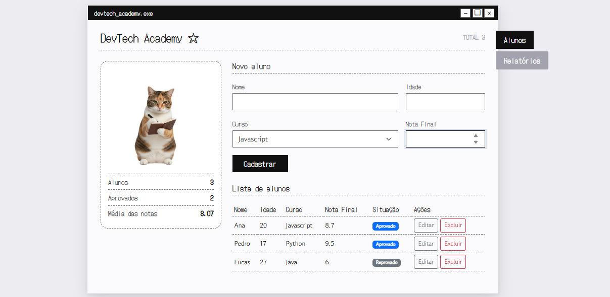
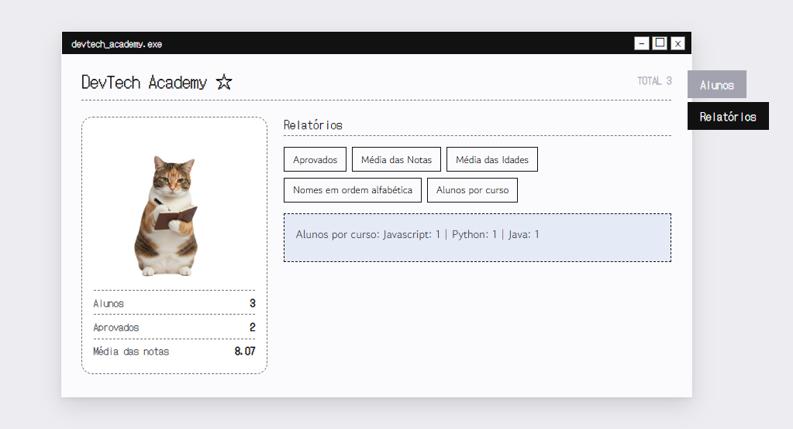

# DevTech Academy ☆

Sistema de gerenciamento de alunos, feito como estudo de caso da faculdade com HTML, CSS, JavaScript e Bootstrap 5.

## Preview

 

## Funcionalidades

- Cadastro, edição e exclusão de alunos (nome, idade, curso e nota final)
- Painel com total de alunos, aprovados (nota ≥ 7) e média das notas
- Relatórios: aprovados, média das notas, média das idades, nomes em ordem alfabética e alunos por curso

## Como executar

Clone o repositório e abra o `index.html` no navegador (é preciso internet para carregar o Bootstrap e as fontes).

> Os dados ficam só em memória: ao recarregar a página, a lista é reiniciada.
